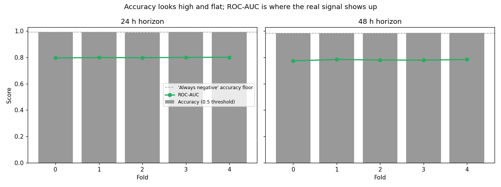

# Data Pipeline: Configuration, Cleaning, Split, Features, Preparation

> **Correction note (2026-11-20):** every count in this document previously matched an intermediate
> pipeline run from before the M3 cohort rules were finalized (168,908 admissions; 137 features; 852,813
> snapshots). That version was never what got submitted. The actual submitted
> `IE7275_GroupA_Project_Proposal_M3.pdf` reports 153,448 admissions, 96 features, and 725,334 snapshots,
> which match the current `data/processed/*.parquet` files and `data/processed/cleaning_report.json`
> exactly. Every number below has been corrected against those two sources (the PDF's own text, and the
> machine-generated `cleaning_report.json`/`features_report.json` it was built from) so this document
> matches what was actually graded.

## 1. Configuration (`config.yaml`)

All decisions live in one file, so the code contains no hard-coded paths or numbers.

| Setting | Value | Reason |
|---|---|---|
| `seed` | 7275 | reproducible split and models |
| `split` | 0.6 / 0.2 / 0.2 | from M2 |
| `readmit_window_days` | 365 | M2 definition of "frequently admitted" |
| `min_readmit_hours` | 1 | changed after M2: a gap under 1 hour is an administrative bounce-back of the same stay, not a readmission |
| `planned_admission_types` | ELECTIVE, SURGICAL SAME DAY ADMISSION | both are scheduled; their ICU stays are planned, not deterioration |
| `icu_units` | 8 true ICUs (MICU, SICU, MICU/SICU, CCU, CVICU, TSICU, Neuro SICU, ICU) | step-down units (Neuro Intermediate, Neuro Stepdown) are not ICUs |
| `non_ward_units` | Emergency Department, ED Observation, Discharge Lounge, Observation, UNKNOWN, plus (changed after M2) Psychiatry, Obstetrics (Antepartum/Postpartum), Labor & Delivery, Nursery, PACU | the patient is not on an inpatient ward there; Psychiatry alone contributed tens of thousands of 0%-transfer-rate snapshots that diluted the watchlist population |
| `snapshot.hour` | 8 | one prediction per morning, matching bed-planning rounds |
| `labs` | item ID plus plausible minimum and maximum | values outside the range are recording errors |
| `drug_classes` | name patterns per class | groups thousands of drug names into 7 classes |
| `comorbidities` | ICD-9 and ICD-10 prefixes | groups diagnosis codes into 7 conditions |

---

## 2. Cleaning (`clean.py`): before and after

### 2.1 Admissions

| Step | Before | Removed or changed | After |
|---|---|---|---|
| Raw admissions | 546,028 | | 546,028 |
| Duplicate `hadm_id` | 546,028 | 0 | 546,028 |
| Discharge time not after admission time (impossible) | 546,028 | 180 removed | 545,848 |
| Death time before admission time | | 11 set to missing | 545,848 |
| Admission overlapping the previous stay | | 47 flagged (not counted as readmissions) | 545,848 |

### 2.2 Transfers

| Step | Before | Removed | After |
|---|---|---|---|
| Raw transfers | 2,413,581 | | 2,413,581 |
| No `hadm_id` (emergency visits without admission) | 2,413,581 | 408,977 | 2,004,604 |
| "discharge" events (not a location) | 2,004,604 | 546,024 | 1,458,580 |
| Out time before in time | | 0 | 1,458,580 |
| Exact duplicates | | 3 | 1,458,577 |
| Kept for cohort admissions | | | 414,892 |

Check: the first ICU entry from `transfers` matches `icustays` within 1 minute for **97.2%** of admissions.

### 2.3 Cohort construction

| Step | Rule | Admissions after | Removed |
|---|---|---|---|
| 0 | all valid admissions | 545,848 | |
| 1 | prior discharge in [1 hour, 365 days] | 227,193 | 318,655 |
| 2 | not planned (ELECTIVE, SURGICAL SAME DAY) | 205,352 | 21,841 |
| 3 | adult (18+) | 205,352 | 0 |
| 4 | has at least one ward stay | 167,789 | 37,563 |
| 5 | not admitted straight to the ICU | **153,448** | 14,341 |

**Final cohort:** 153,448 admissions, 55,012 patients, 10,108 (6.6%) with an unplanned ward-to-ICU transfer.

Why the frequent-admission rule is applied per admission (has a previous admission within 365 days)
and not per patient: a per-patient rule would use **future** admissions to decide who is in the cohort,
which the model cannot know at prediction time. The 1-hour floor on step 1 (added after M2) excludes
administrative bounce-backs of the same stay from counting as a readmission.

### 2.4 Labs (`labevents`, 2.6 GB)

Streamed in 64 MB blocks with pyarrow, keeping only cohort admissions and the 21 selected tests.

| Step | Before | Removed or changed | After |
|---|---|---|---|
| Raw rows read | 158,374,764 | | |
| Cohort admissions and 21 tests | 158,374,764 | 145,822,089 not needed | 12,552,675 |
| No numeric value (e.g. "hemolyzed", "see comment") | 12,552,675 | 54,679 | 12,497,996 |
| Release time before draw time | | 39 fixed (set to draw time) | |
| Implausible values (outside config range) | 12,497,996 | 318 | 12,497,678 |
| Duplicate results | 12,497,678 | 1,306 | **12,496,372** |

Implausible values by test: glucose 94, magnesium 62, creatinine 58, calcium 48, sodium 12, potassium 9,
anion gap 5, pO2 5, bicarbonate 4, chloride 4, albumin 4, bun 3, pH 3, pCO2 2, hemoglobin 2, bilirubin 1,
lactate 1, INR 1. These are recording or unit errors (e.g. a pH of 70), not genuine extremes, so they are
removed. Genuine extremes inside the range are kept: a lactate of 15 mmol/L is rare but real and is
exactly the signal the model needs.

### 2.5 Prescriptions

| Step | Before | Removed | After |
|---|---|---|---|
| Raw rows read | 20,292,611 | | |
| Cohort admissions | 20,292,611 | 13,737,658 | 6,554,953 |
| Missing start time or drug name | 6,554,953 | 9,682 | 6,545,271 |
| Duplicate orders | 6,545,271 | 606,938 | **5,938,333** |

Drug names were lower-cased and grouped into classes: anticoagulant 339,993 orders, opioid 308,232,
antibiotic 278,659, insulin 253,511, diuretic 190,112, vasopressor 15,183, ACE inhibitor 39,640.

**Duplicate definition:** a prescription row is a duplicate if it shares `(hadm_id, starttime, drug,
route)` with an earlier row — not an exact full-row duplicate (`clean.py` only reads these 4 columns
from `prescriptions.csv.gz`, so no other column can distinguish two rows anyway).

**Why ~9% is not negligible, and why the key is still right:** sampling the cohort-filtered raw table and
joining back `poe_id` (the pharmacy order id, not used in the pipeline) shows that about 58% of
duplicate-key groups share the *same* `poe_id` — MIMIC-IV logs one row per product/strength line used to
fill a single order (e.g. a 1.25 mg dose split into a 1 mg and a 0.25 mg syringe, or a dose built from
two NDC codes), not one row per clinical decision. Collapsing those to one row is correct: without it, a
single order would inflate `rx_new_24h` and the per-class counts in `features.py` by however many
formulary lines it took to fill it. The remaining ~42% of duplicate groups do *not* share a `poe_id` —
these are genuinely separate orders that coincidentally match on admission, start time, drug name, and
route (most plausibly two scheduled/standing-order renewals issued at the same routine administration
time, e.g. 09:00 or 22:00). Collapsing these slightly undercounts same-time distinct orders, but only at
the daily-snapshot granularity the features use, so the effect on `rx_new_24h` is at most "off by one"
per collision — a smaller error than the alternative of inflating counts for the majority case. A more
precise key would deduplicate by `poe_id` when present and fall back to `(hadm_id, starttime, drug,
route)` only when it is missing; this is a reasonable follow-up if medication-order features turn out to
matter for the model.

### 2.6 Outpatient measurements (`omr`)

| Step | Before | Removed | After |
|---|---|---|---|
| Rows for cohort patients | 3,775,380 | | |
| Blood pressure "120/80" split into systolic and diastolic | 3,775,380 | | more rows (one per measure) |
| Unparsable values | | 0 | |
| Implausible (diastolic 1,133, BMI 618, weight 569, systolic 10) | | 2,330 | |
| Same patient, day and measure averaged | | | **4,435,808** |

### 2.7 Diagnoses and services

| Table | Before | Removed | After |
|---|---|---|---|
| Diagnoses (cohort patients) | | 288 duplicate codes | 4,111,743 |
| Services (cohort admissions) | | 0 duplicates | 168,442 |

### 2.8 Output files (`data/processed/`)

| File | Rows | Columns |
|---|---|---|
| `cohort.parquet` | 153,448 | 12 |
| `admissions_all.parquet` | 545,848 | 5 |
| `transfers.parquet` | 414,892 | 6 |
| `labs.parquet` | 12,496,372 | 5 |
| `prescriptions.parquet` | 5,938,333 | 10 |
| `omr.parquet` | 4,435,808 | 4 |
| `diagnoses.parquet` | 4,111,743 | 4 |
| `services.parquet` | 168,442 | 3 |

---

## 3. Split (`split.py`): before and after

Before: 153,448 admissions from 55,012 patients in one table.
After: every **patient** is assigned to exactly one split, stratified by whether the patient ever had
a ward-to-ICU transfer, with seed 7275.

| Split | Patients | Admissions | Admissions with ICU transfer |
|---|---|---|---|
| Train | 33,006 | 91,786 | 6.60% |
| Validation | 11,003 | 31,331 | 6.41% |
| Test | 11,003 | 30,331 | 6.72% |

Why split by patient: one patient has several admissions and many daily snapshots. If the same patient
were in both train and test, the model could memorize that patient and the test score would be too
optimistic. The split is made **before** any exploration, and the test set is not used until final
evaluation.

---

## 4. Features (`features.py`): before and after

### 4.1 From admissions to daily snapshots

| Step | Rows |
|---|---|
| Cohort admissions | 153,448 |
| Candidate 08:00 snapshots (from admission until first ICU entry, discharge or death) | 738,248 |
| Dropped: patient not on a ward at 08:00 (still in the emergency department, discharge lounge, ...) | 12,914 |
| **Final snapshots** | **725,334** |

### 4.2 Illustrative example (fictional patient, not real data)

```
Day 0  14:00  admitted from the emergency department to a Medicine ward
Day 1  08:00  snapshot 1 -> features use labs released before 08:00 on day 1
Day 2  08:00  snapshot 2 -> lactate result released at 06:30 is included
Day 2  21:00  transferred to MICU
              snapshot 1: ICU transfer 61 h later -> y_24h = 0, y_48h = 0
              snapshot 2: ICU transfer 13 h later -> y_24h = 1, y_48h = 1
              no snapshot on day 3: the patient is already in the ICU
```

### 4.3 Labels

| Label | Rule | Positive snapshots | Rate |
|---|---|---|---|
| `y_24h` | first ICU entry in (snapshot, snapshot + 24 h] | 6,517 | 0.90% |
| `y_48h` | first ICU entry in (snapshot, snapshot + 48 h] | 11,241 | 1.55% |

Coverage limit: of the 6,060 training admissions with a later ward-to-ICU transfer, 31.3% occur at or
before the first 08:00 snapshot (median time to ICU 29.8 h, 25th percentile 6.0 h, training split). These
early deteriorations cannot be predicted with morning snapshots and are a coverage limit of the product,
not a labeling bug; they should be discussed in the report.

### 4.3a Competing outcome: ward death without an ICU transfer

A patient who deteriorates and dies on the ward within the label window, without ever being transferred
to the ICU, has `first_icu_time` missing (or after death), so `y_{h}h` is `0` for that snapshot — the
same label as a patient who stays stable. `features.py` now counts this case explicitly
(`died_no_icu_in_window_{h}h` in `features_report.json`), using the current pipeline run:

| Horizon | Snapshots labeled 0 where death occurs in-window, no prior ICU | Share of all snapshots | Share of `y=0` snapshots | Distinct admissions |
|---|---|---|---|---|
| 24 h | 857 | 0.118% | 0.119% | 857 |
| 48 h | 1,707 | 0.235% | 0.239% | 922 |

**Why `y=0` is kept rather than relabeling these as positive:** the research question is specifically
about *unplanned ICU transfer* as an actionable event the watchlist should flag — ward death without a
transfer is a different pathway (e.g. a comfort-care/DNR decision after a transfer was declined, or
deterioration too rapid for a transfer to occur), not a missed instance of the same outcome. Relabeling
it as positive would train the model to also flag patients who are not being escalated by design. At
0.12–0.24% of snapshots (1.2–1.6% of the already-rare positive class), this is also too small a group to
materially change ranking metrics either way — a sensitivity run with these snapshots excluded from the
validation set would be a cheap way to confirm that explicitly before the M4 submission.

### 4.4 Leakage checks (all passed)

| Check | Result |
|---|---|
| Snapshots at or after the ICU entry | 0 |
| Snapshots at or after discharge | 0 |
| Duplicate (admission, snapshot time) rows | 0 |
| Labs used only if released before the snapshot (`storetime`, not draw time) | by construction |
| Diagnoses only from earlier discharges | by construction |

### 4.5 Output

| | Before | After |
|---|---|---|
| Shape | 8 cleaned long tables | one wide table, 725,334 rows x 101 columns |
| Columns | | 3 IDs + 2 labels + 96 features (92 numeric, 4 categorical) |

---

## 5. Preparation (`prepare.py`): before and after

All statistics are fitted on the **training split only** (436,541 snapshots) and then applied to
validation and test.

### 5.1 Two views of the same features

| Model | Input | Missing values | Scaling | Categoricals |
|---|---|---|---|---|
| LightGBM | 96 raw features | kept as missing: the model learns that "lab not ordered" is informative (Figure 4) | not needed for trees | pandas categories, levels from train |
| Logistic regression *(not part of the current M4 model; `prepare.py::build_preprocessor` still supports it if reintroduced)* | 194 columns | median of train + 46 missing-indicator columns | standardized (mean 0, sd 1) | one-hot: 56 columns |

**`<lab>_delta` when only one result exists:** `features.py` computes `{lab}_delta` as the change from
the previous result (`valuenum - prev_value`); when a lab has been drawn only once in the lookback
window, `prev_value` is `NaN`, so `_delta` is `NaN` too — this is not an edge case, it is the common case
for low-frequency labs. For LightGBM the column is left missing, same as any other missing lab (the
model can split on "no second draw yet" through the native missing-value path). For logistic regression
it goes through the same `ColumnTransformer` as every other numeric feature: median-imputed on the
training split with an added missing-indicator column, so the model sees "delta = training median" plus
a binary flag that a delta could not be computed, rather than failing on `NaN`.

### 5.2 Before and after, training split

| Feature | Before: mean | Before: sd | Before: missing | Median used to fill | After: mean | After: sd | After: missing |
|---|---|---|---|---|---|---|---|
| age (years) | 63.86 | 16.36 | 0% | 65 | 0.00 | 1.00 | 0% |
| hours since admission | 147.5 | 249.1 | 0% | 78.8 | 0.00 | 1.00 | 0% |
| creatinine, last (mg/dL) | 1.44 | 1.63 | 11.4% | 0.90 | 0.00 | 1.00 | 0% |
| lactate, last (mmol/L) | 1.60 | 0.73 | 78.4% | 1.50 | 0.00 | 1.00 | 0% |
| WBC, last (K/uL) | 7.82 | 6.77 | 9.8% | 6.90 | 0.00 | 1.00 | 0% |
| outpatient systolic BP (mmHg) | 126.9 | 19.8 | 27.1% | 126 | 0.00 | 1.00 | 0% |
| new medication orders, 24 h | 6.47 | 6.39 | 0% | 4 | 0.00 | 1.00 | 0% |

Overall, 20.6% of numeric cells in the training data are missing before preparation and 0% after.

### 5.3 Categorical encoding

| Variable | Levels in train | One-hot columns |
|---|---|---|
| admission_type | 7 | part of 56 |
| admission_location | 11 | part of 56 |
| careunit (ward unit) | 24 | part of 56 |
| curr_service | 19 | part of 56 |

Levels seen in less than 0.1% of training rows are merged into an "infrequent" column; levels never seen
in training are handled without error.

### 5.4 Dimension reduction (`notebooks/02_pca.ipynb`)

PCA on the 13 routine labs (under 30% missing): 8 components are needed for 80% of the variance and 10
for 90%, so compression is small, and the components are harder to explain than named labs. Decision:
keep the raw lab features for LightGBM.

---

## 6. Result of the pipeline: LightGBM, 5-fold cross-validation (M4)

`python -m icu_forecast.models.train` is the one command that rebuilds every number below. It builds 5
folds on the combined train+validation patient pool (grouped by patient, stratified on whether the
patient ever had a ward-to-ICU transfer — the same variable `split.py` stratifies on), refits LightGBM's
categorical levels inside each fold from that fold's own training patients, and never reads the test
split. Results are written to `reports/tables/lgbm_5fold_cv.csv`.

**Scope note:** this milestone's model is LightGBM only. The M4 instructions ask for a trivial reference
and at least two baseline models from different families; the `reference.py` (class-prior), `logreg.py`
(linear), and `knn.py` (instance-based) baselines described in earlier drafts of this repository were
dropped in favor of validating LightGBM more thoroughly via cross-validation instead of a single fixed
split. **This means that requirement is not currently satisfied** — stated here plainly rather than
glossed over, since the team should decide whether to restore a second baseline before submission.

| Horizon | ROC-AUC (mean ± std, 5 folds) | PR-AUC | Recall @ top 10% | Precision @ top 10% | Accuracy (0.5 threshold) |
|---|---|---|---|---|---|
| 24 h | 0.799 ± 0.002 | 0.083 ± 0.008 | 46.4% ± 1.3% | 4.14% ± 0.21% | 99.1% |
| 48 h | 0.781 ± 0.004 | 0.089 ± 0.004 | 41.7% ± 1.0% | 6.41% ± 0.35% | 98.5% |

LightGBM is trained with `metric="auc"` (early stopping itself tracks ROC-AUC, not PR-AUC), which is why
ROC-AUC is the headline metric here: at this prevalence (<2%), it is not distorted by class imbalance the
way accuracy is. The accuracy column is included specifically to show that: it sits barely above the
"always predict negative" floor (99.1%/98.5%) despite ROC-AUC showing real discrimination — see Figure 10.
The tight spread across folds (±0.002–0.004 ROC-AUC) indicates the result is stable, not a lucky single
split. The most important LightGBM inputs (Figure 8, from an earlier single-split fit, not regenerated by
the current 5-fold script) are new IV medication orders in the last 24h, the latest white-cell count, the
ward unit, the current service, and time since admission.

---

## 7. How to reproduce

```bash
pip install -r requirements.txt
python -m icu_forecast.clean
python -m icu_forecast.split
python -m icu_forecast.features
python -m icu_forecast.prepare
python -m icu_forecast.models.train
```

---

## Appendix: figures (training split)


**Figure 1.** Share of training snapshots followed by an ICU transfer within 24 h and 48 h.


**Figure 2.** Hours from admission to ICU transfer; 31% of transfers happen before the first 08:00 snapshot.


**Figure 3.** ICU transfer rate by decile of six key labs.


**Figure 4.** Transfer rate when a lab was or was not measured in the last 24 h.


**Figure 5.** Spearman correlation among the latest lab values.


**Figure 6.** Transfer rate by ward unit and by day of stay.


**Figure 7.** Variance explained by the principal components of the 13 routine labs.


**Figure 8.** Top 20 LightGBM features for the 24 h model, by share of split gain.


**Figure 9.** Precision-recall curves on a single validation split, from an earlier draft that also
trained a reference, logistic regression, and k-NN baseline alongside LightGBM. Kept for reference; not
regenerated by the current 5-fold `models/train.py`, which trains LightGBM only.



**Figure 10.** Accuracy at a 0.5 threshold, per fold, against the "always predict negative" floor and
against ROC-AUC. Accuracy is high and flat (99.1%/98.5%) and barely above the floor, while ROC-AUC
(~0.80/0.78) shows the model's actual discrimination — why accuracy is never used as a criterion in this
project, drawn out explicitly rather than just asserted.
